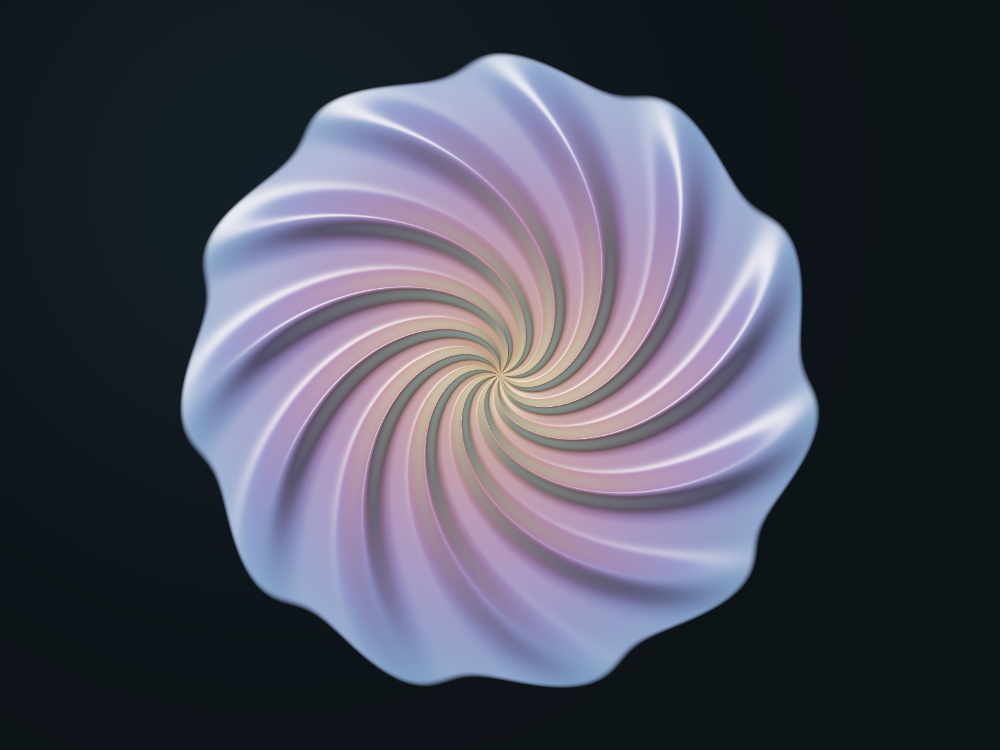

# NACRE

NACRE is a small, inspectable pixel-art program: a pearl-like spiral whose appearance is computed from explicit equations in JavaScript/GLSL and reproduced independently with NumPy. It is procedural illustration, not a fluid simulation or a learned image generator.

Live page: [arkhē.org/nacre](https://www.xn--arkh-eva.org/nacre/).  
Repository: [github.com/AdemVessell/nacre](https://github.com/AdemVessell/nacre).



The interactive page has five construction views, a guided reveal, live parameters, presets, pixel inspection, source disclosure, and PNG/JSON export. Phase animation changes the formula's phase; it does not simulate fluid motion.

## Run it

Clone the repository. The browser artwork needs only a local static server; the pinned Python environment below is for independent reproduction:

```sh
git clone https://github.com/AdemVessell/nacre.git
cd nacre
python3 -m venv .venv
.venv/bin/python -m pip install -r requirements.txt
```

Serve the interactive page locally:

```sh
python3 -m http.server 8772 --bind 127.0.0.1
```

Open <http://127.0.0.1:8772/>. There is no build step, account, remote asset, or API key. WebGL2 evaluates the formula in parallel; a JavaScript CPU path handles browsers without WebGL2. KaTeX and its fonts are vendored.

Try **Play construction**, then set **relief to zero** to remove the apparent sculpting. Change **arms** to alter the fold count, reverse **twist**, or animate **phase**. The five views isolate ingredients; they are explanatory views, not five cumulatively added image layers.

## The equations

The complete contract, including validation, regularization, derivatives, stages, and byte conversion, is [SPEC.md](SPEC.md). At a pixel `(i,j)`, with image width `W` and height `H`, the program first uses aspect-correct coordinates:

$$
x=\frac{2i+1-W}{H},\qquad y=\frac{H-2j-1}{H}.
$$

The radial phase field winds an integer number of arms while adding a logarithmic twist:

$$
r=\max(\sqrt{x^2+y^2},10^{-4}),\qquad \theta=\mathrm{atan2}(y,x),
$$

$$
q=n\theta-k\log(r^2+0.008)+\phi,\qquad f=\frac{1+\cos q}{2}.
$$

The height is an authored relief field. `E`, `B`, and `A` keep it finite at the centre and fade it toward the rim:

$$
E=e^{-(r/0.76)^8},\qquad B=1-e^{-r^2/0.008},\qquad A=EB,
$$

$$
H=0.10 \rho A(0.16+f^3).
$$

The reference computes the derivatives analytically rather than estimating them from neighbouring pixels:

$$
f_r=\frac{kr}{r^2+0.008}\sin q,\qquad f_\theta=-\frac{n}{2}\sin q,
$$

$$
H_x=H_r\frac{x}{r}-H_\theta\frac{y}{r^2},\qquad
H_y=H_r\frac{y}{r}+H_\theta\frac{x}{r^2},
$$

$$
N=\mathrm{normalize}(-H_x,-H_y,1).
$$

An authored light direction turns `N` into diffuse and specular terms. The palette is:

$$
P=0.58+0.31\cos\left(3r+0.6N_z+\text{hue}+(0,1.2,2.7)\right).
$$

The selected construction stage blends its colour with a smooth radial mask and the dark background. The finished stage adds grazing tint, then maps colour to display values:

$$
D=\left(1-e^{-1.25\max(c,0)}\right)^{1/2.2},
\qquad \text{byte}=\left\lfloor255D+0.5\right\rfloor.
$$

The CPU colour core is disclosed in `reference.py`; the browser core is disclosed in `src/nacre.js` and exposed as `Nacre.source`. That exposed colour core is 26 lines and 1,591 UTF-8 bytes. The measurement covers only the colour core, not validation, UI, GPU wrapper, KaTeX, fonts, or the rest of the site.

## Reproduce the pixels

The independently written NumPy reference is directly runnable. Use Python 3.9 or newer with the pinned dependencies above. The cross-language `verify.py` command also requires Node.js on PATH (the recorded run used Node v26.12.1):

```sh
.venv/bin/python reference.py \
  --state proof/default-state.json \
  --width 1600 --height 1200 \
  --output reproduced.png \
  --raw reproduced.rgba

.venv/bin/python -m unittest test_reference.py -v
.venv/bin/python verify.py
```

The CLI accepts individual options such as `--arms 7 --twist -4 --relief .8`, a plain parameter JSON object, or the browser's strict export format:

```json
{"format":"nacre-state-1","state":{"arms":11,"twist":5.5,"relief":1,"hue":0,"light":0,"phase":0,"stage":4}}
```

Pass that JSON as `--state '{...}'`, or save it and use `--state @state.json`. `--raw` writes row-major RGBA bytes. Inputs outside the declared contract are rejected.

For browser checks, serve the repository and open [proof/qa.html](proof/qa.html), then click **Run pixel checks**. The saved browser receipt describes one WebGL2 device run; it is not a guarantee about every GPU.

## Bounded evidence

- [CPU_REPORT.json](proof/CPU_REPORT.json) records 69 parameter states × 176 coordinates = 36,432 floating RGB values. The maximum JS/NumPy difference was 1.45×10⁻¹⁴. The full 1200×900 RGBA buffers matched exactly, with zero differing bytes.
- 15 reference tests cover analytic-gradient finite differences, a deliberately wrong gradient that must fail, zero-relief normals, angle/phase continuity, stage independence, validation, regularization boundaries, and CLI state reproduction.
- [BROWSER_REPORT.json](proof/BROWSER_REPORT.json) records 20 passing checks. Across nine 600×450 views/parameter cases, the largest GPU/CPU difference was one level in an 8-bit channel; repeated GPU draws matched exactly on that browser.
- [REPORT.json](proof/REPORT.json) is the combined receipt. [UI_REPORT.json](proof/UI_REPORT.json) records interaction observations and remaining automation limits.
- [nacre.png](proof/nacre.png) is the independent 1600×1200 finished image; [default-state.json](proof/default-state.json) contains its parameters. Stage images are saved beside it.

The reference was authored by a separate Codex agent from `SPEC.md` without reading the JavaScript implementation, then compared against the browser program. This is a software provenance boundary, not a claim of human independent review. The evidence supports implementation agreement for the tested states, not a proof for every possible state. CPU double precision and GPU arithmetic are not universally bit-identical, and the centre regularization has a documented boundary discontinuity.

NACRE is a compact artwork program, not a general engine for arbitrary imagery. Other subjects require new authored functions. No speed or quality superiority over other shader-authoring workflows has been established.

## Tools and provenance

Created with Codex using JavaScript, bare WebGL2/GLSL, HTML/CSS, and KaTeX; Python, NumPy, and Pillow for independent reproduction; Node.js for cross-checks; and Chrome for live rendering and interaction checks. No image-generation model supplied the artwork pixels. Design explorations and repaired first-run issues remain in `exploration/` and `BUILD_LOG.md`.

Third-party notices are retained under `vendor/licenses/` and `vendor/katex/`. See [NOTICE.md](NOTICE.md). This repository grants no blanket open-source licence; third-party licences apply to their respective components.
